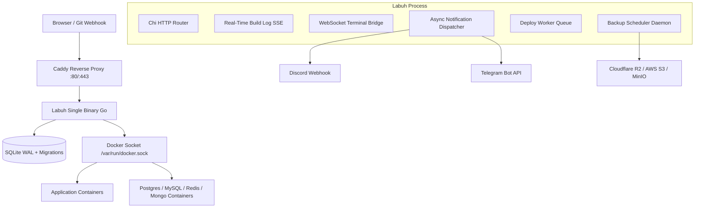

# Arsitektur & Spesifikasi Fitur Labuh PaaS

Labuh adalah PaaS (*Platform as a Service*) open source ultra-ringan yang dikompilasi menjadi **single binary Go**, dirancang sebagai alternatif minimalis untuk Coolify pada arsitektur Single-Node VPS.

---

## 🏛️ Arsitektur Inti

---

## 📦 5 Fitur Utama (ATM Coolify)

### 1. Git Webhook Auto-Deploy (GitHub, GitLab, Gitea)
- **HMAC SHA256 Signature Verification**: Melindungi endpoint webhook publik (`/api/v1/webhooks/{app_id}`) dari request palsu.
- **Auto Branch Mismatch Guard**: Mengabaikan push event yang bukan ke branch target aplikasi.
- **Trigger**: Menambahkan deployment baru ke deployment queue secara instan dan mengembalikan status commit.

### 2. Multi-Config S3/R2 Database Backup & Pruning Engine
- **Pure Go SigV4 REST Client**: Berkomunikasi langsung dengan AWS S3, Cloudflare R2, MinIO, Wasabi, Backblaze B2 tanpa SDK eksternal besar.
- **On-the-fly Docker Streaming & Gzip**: Menjalankan `pg_dump`, `mysqldump`, `mongodump`, atau `redis-cli` via Docker exec streaming langsung ke `compress/gzip` di Go tanpa membengkakkan memori server.
- **Background Cron Scheduler**: Evaluasi per menit untuk auto-backup database.
- **Retention Pruning**: Menghapus snapshot remote dan lokal saat melebihi jumlah retensi yang dikonfigurasi.

### 3. Interactive Web Console / Exec Terminal (xterm.js + WebSocket)
- **Pure Go Terminal Bridge**: Berbasis `coder/websocket` dan Docker Exec Hijack API dengan alokasi Pseudo-TTY (`/bin/sh` fallback `/bin/bash`).
- **Dynamic PTY Resize**: Sinkronisasi dimensi baris/kolom terminal xterm.js secara realtime ke Docker daemon.
- **Security Guard**: Proteksi session authentication berbasis cookie, mencegah akses konsol tanpa login.

### 4. Multi-Channel Notifications (Telegram Bot & Discord Webhooks)
- **Arsitektur Multi-Tier (Opsi B)**:
  - *Global Organization Channel*: Menerima alert dari seluruh project dan database.
  - *Project-Level Override*: Channel terisolasi khusus menerima event dari project tertentu.
- **Granular Event Toggles**: `deploy_success`, `deploy_failure`, `backup_success`, `backup_failure`.
- **Non-blocking Asynchronous Dispatch**: Notifikasi dikirimkan dalam goroutine terpisah sehingga kegagalan network webhook eksternal tidak memperlambat pipeline deployment atau backup.

### 5. Container Resource Limits & Dynamic Throttling (CPU & RAM)
- **Presisi Alokasi**:
  - CPU Cores dikonversi ke Docker `NanoCPUs` ($cores \times 10^9$).
  - RAM dikonversi ke bytes ($MB \times 1024 \times 1024$) dengan dukungan hard limit (`memory_limit`) dan soft guarantee (`memory_reservation`).
- **Live Dynamic Throttling**: Menggunakan Docker API `ContainerUpdate` untuk menerapkan batas resource secara langsung ke container yang **sedang berjalan tanpa perlu restart**.
- **Universal Guard**: Berlaku untuk container aplikasi (Blue-Green candidate) maupun container database mandiri.
